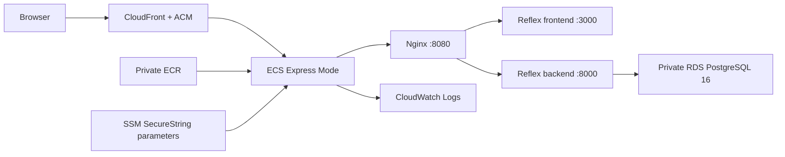

# Debriefly

Debriefly is a [Reflex](https://reflex.dev/) web application for creating and
running cognitive debriefing surveys. The production application is available
at [https://www.debriefly.net](https://www.debriefly.net).

Production runs on AWS. NERC OpenShift is no longer the deployment platform.
The application source lives in this repository, while the AWS resources and
the production image adapter live in the separate
[`debriefly-infra`](https://github.com/iqss-research/debriefly-infra)
repository.

| Goal | Start here |
| --- | --- |
| Run Debriefly locally | [Local development](#local-development) |
| Provision the complete AWS stack | [Deploy the complete system on AWS](#deploy-the-complete-system-on-aws) |
| Release a new application commit | [Routine AWS releases](#routine-aws-releases) |
| Diagnose a deployment | [Troubleshooting](#troubleshooting) |

> [!IMPORTANT]
> The application `Dockerfile` exposes the Reflex frontend and backend on two
> ports. Do not deploy it directly to ECS Express Mode. AWS deployments must
> use the single-port Nginx adapter in `debriefly-infra/container/` and the
> `debriefly-infra/scripts/build-and-push.sh` helper. The tag-triggered GitHub
> workflow in this repository publishes the legacy Docker Hub image; it does
> not release to AWS.

## AWS architecture



OpenTofu in `debriefly-infra` creates:

- a private ECR repository with immutable tags and scan-on-push enabled;
- an ECS Express Mode service running one 0.5-vCPU, 2-GiB task;
- Nginx on port 8080, routing `/_event`, `/_upload`, and `/ping` to the
  Reflex backend and all other requests to the frontend;
- a private, encrypted PostgreSQL 16 RDS instance;
- SSM SecureString parameters and narrowly scoped ECS execution roles for
  database, authentication, SMTP, and optional global OpenAI secrets;
- a CloudWatch log group;
- a CloudFront distribution with caching disabled for the dynamic application;
  and
- an ACM certificate for the public domains.

`/health` verifies that Nginx is alive. `/ready` verifies both the Reflex
backend and frontend, and is the deployment readiness check. RDS is the only
durable application store; the task filesystem is ephemeral.

## Local development

### Prerequisites

- Python 3.12 is recommended. The package supports Python 3.10 or newer.
- `pip` or [`uv`](https://docs.astral.sh/uv/)
- Git

### Install

```sh
git clone https://github.com/iqss-research/debriefly.git
cd debriefly
python3 -m venv .venv
source .venv/bin/activate
python -m pip install --upgrade pip
python -m pip install -r requirements.txt
python -m pip install -e . --no-deps
```

To have `uv` install Python 3.12 as well as create the environment:

```sh
uv venv --python 3.12
source .venv/bin/activate
uv pip install -r requirements.txt
uv pip install -e . --no-deps
```

### Configure and run

Copy the environment template and replace its placeholder values:

```sh
cp .env.sample .env
openssl rand -hex 32
```

Use the generated value for `AUTH_SECRET_KEY`. Keep the local URLs and ports
from `.env.sample`: the frontend runs on port 3000 and the backend on port
8000. Configure SMTP if registration, verification, password reset, or
feedback email needs to work locally.

Never commit `.env`, credentials, API keys, database files, or exported user
data.

Start Debriefly:

```sh
./debriefly
```

The helper initializes and migrates a local SQLite database, adds seed data,
and starts Reflex with hot reload. Open
[http://localhost:3000](http://localhost:3000). After signing in, use
**OpenAI Key** in the sidebar to save a standard OpenAI API key for debriefing
chats.

Run the checks before opening a pull request:

```sh
pre-commit run --all-files
pytest
```

When a model change causes Reflex to create an Alembic revision, review it and
commit it under `alembic/versions/`. Production startup applies every committed
migration before starting the application.

## Deploy the complete system on AWS

The instructions below are the production deployment path. They are written
for an authorized Debriefly operator and use the official AWS account,
`066523631881`, in `us-east-2`. The infrastructure deploy script deliberately
rejects every other account, and its encrypted state belongs to the official
environment. See [Deploying to another AWS account or domain](#deploying-to-another-aws-account-or-domain)
before adapting it for an independent installation.

All commands in this section run in one Bash session from the
`debriefly-infra` directory unless a command says otherwise.

> [!NOTE]
> These steps assume the AWS readiness, SMTP, account-safety, and startup-grace
> changes in `debriefly-infra` have been reviewed, committed, and pushed. Do
> not deploy from an infrastructure worktree with unpublished changes. The
> application README and infrastructure revision must describe the same
> release contract.

### 1. Get access and install the tools

You need:

- access to both private GitHub repositories;
- an AWS administrator profile for account `066523631881`;
- the existing OpenTofu state key and runtime secrets from the approved secret
  manager;
- permission to edit DNS for the public domains;
- a working SMTP account and verified sender domain; and
- Bash, Git, `jq`, `curl`, Docker with Buildx, `asdf`, and GitHub CLI.

The infrastructure repository's current small-production estimate is roughly
USD 52–60 per month before traffic, excess logs, and backups. Treat that as an
estimate, and review current AWS pricing and the
[hardening choices below](#production-hardening-and-operations) before
applying anything.

Clone the repositories as siblings. The build helper depends on this layout:

```text
workspace/
├── debriefly/
└── debriefly-infra/
```

Authenticate GitHub before cloning the private repositories:

```sh
gh auth status || gh auth login
gh auth setup-git
```

```sh
mkdir debriefly-workspace
cd debriefly-workspace
git clone https://github.com/iqss-research/debriefly.git
git clone https://github.com/iqss-research/debriefly-infra.git
cd debriefly-infra
```

Enter Bash and keep this shell open for the rest of the deployment:

```sh
bash
```

The infrastructure repository pins OpenTofu and AWS CLI versions:

```sh
asdf plugin list | grep -qx opentofu || \
  asdf plugin add opentofu https://github.com/virtualroot/asdf-opentofu.git
asdf plugin list | grep -qx awscli || \
  asdf plugin add awscli https://github.com/MetricMike/asdf-awscli.git
asdf install

docker buildx version
jq --version
```

For the official environment, retrieve `access_key_id` and
`secret_access_key` from **Debriefly AWS admin**, `state_key` from
**Debriefly OpenTofu state key**, and the database, authentication, and SMTP
values from **Debriefly runtime secrets** in the Debriefly 1Password vault.

### 2. Authenticate to the correct AWS account

Create the local profile by entering the access key ID and secret at the
prompts. Do not put either credential on a command line.

```bash
unset AWS_ACCESS_KEY_ID AWS_SECRET_ACCESS_KEY AWS_SESSION_TOKEN
aws configure --profile debriefly-admin
export AWS_PROFILE=debriefly-admin
export AWS_REGION=us-east-2
export AWS_DEFAULT_REGION=us-east-2

if [[ "$(aws sts get-caller-identity --query Account --output text)" \
  != 066523631881 ]]; then
  echo 'Refusing to deploy to an unexpected AWS account.' >&2
  exit 1
fi
aws sts get-caller-identity
```

Stop if the account or identity is not the expected one.

Before changing the infrastructure, coordinate with the other operators and
start from the latest clean `main` and encrypted state:

```sh
git switch main
git pull --ff-only
test -z "$(git status --porcelain --untracked-files=all)"
```

Only one operator may run OpenTofu against this local state at a time.

### 3. Restore the state key and load runtime secrets

The repository versions encrypted local OpenTofu state. Restore its existing
key without exposing the key in shell history:

```bash
umask 077
read -r -s -p 'Paste the OpenTofu state key: ' state_key
printf '\n'
printf '%s\n' "$state_key" > .key.txt
unset state_key
chmod 600 .key.txt
```

`.key.txt` is ignored by Git. Losing this key makes the encrypted state
unrecoverable, so it must remain backed up in the approved secret manager.

Load the application secrets into the same Bash session:

```bash
read -r -s -p 'Paste the database password: ' TF_VAR_db_password
printf '\n'
export TF_VAR_db_password

read -r -s -p 'Paste the authentication signing key: ' TF_VAR_auth_secret_key
printf '\n'
export TF_VAR_auth_secret_key

read -r -s -p 'Paste the SMTP username: ' TF_VAR_smtp_username
printf '\n'
export TF_VAR_smtp_username

read -r -s -p 'Paste the SMTP password/API key: ' TF_VAR_smtp_password
printf '\n'
export TF_VAR_smtp_password
```

Requirements:

- `TF_VAR_db_password` must contain 16–128 characters;
- `TF_VAR_auth_secret_key` must be unpredictable and at least 32 characters;
  and
- both SMTP values must be non-empty.

Researchers normally store their own OpenAI keys in Debriefly. If the
deployment also needs a global fallback key, load `TF_VAR_openai_api_key` with
the same hidden-prompt pattern.

Environment variables disappear when this shell exits. Never save these
values in `terraform.tfvars`, `deployment.auto.tfvars.json`, Git, tickets,
logs, or chat.

### 4. Select and verify the application commit

Deploy a reviewed full commit SHA from `main`, not a moving branch name:

```bash
application_commit="PASTE_FULL_40_CHARACTER_GIT_SHA"
git -C ../debriefly fetch origin
git -C ../debriefly merge-base --is-ancestor \
  "$application_commit" origin/main
git -C ../debriefly switch --detach "$application_commit"
test -z "$(git -C ../debriefly status --porcelain --untracked-files=all)"
```

Confirm the GitHub test workflow passed for that commit. If the local Python
environment is installed, run the checks again:

```sh
(
  cd ../debriefly
  source .venv/bin/activate
  pre-commit run --all-files
  pytest
  python scripts/check_migration_head.py 2f4c8a1d9e7b
)
```

When the migration head changes in a later release, use that release's
reviewed head instead of `2f4c8a1d9e7b`.

### 5. Provision the AWS foundation on the first deployment

Skip this step when updating the existing environment. In particular, never
clear its current `image_digest`.

> [!WARNING]
> Before provisioning a brand-new service, confirm that the infrastructure
> revision contains a tested first-start strategy for Reflex's several-minute
> frontend build. The current startup-grace helper can update an existing ECS
> service but cannot set its grace period before that service first exists.
> Until the infrastructure handles this bootstrap explicitly, use `/health`
> for the first service creation, set and verify at least 900 seconds of ECS
> health-check grace, then change the managed check to `/ready`. Do not assume
> the existing-service release path proves a fresh bootstrap.

For a genuinely empty infrastructure state, set these initial values in
`deployment.auto.tfvars.json`, replacing the commit:

```json
{
  "additional_allowed_origins": [],
  "application_commit": "PASTE_FULL_40_CHARACTER_GIT_SHA",
  "custom_domains": [
    "debriefly.net",
    "www.debriefly.net"
  ],
  "custom_domain_ready": false,
  "image_digest": null,
  "primary_custom_domain": "www.debriefly.net",
  "smtp_credentials_version": 1
}
```

Review the plan, then apply it:

```sh
./scripts/deploy.sh
./scripts/deploy.sh --apply
```

This first apply creates the VPC-related security groups, RDS, ECR, the ECS
cluster, IAM roles, SSM parameters, CloudWatch Logs, and the ACM certificate.
It does not create the ECS service or CloudFront until an image digest exists.

After this and every successful apply, immediately commit and push the updated
encrypted state and any intentional configuration change before continuing:

```sh
git status --short
git add deployment.auto.tfvars.json terraform.tfstate
git commit -m "Checkpoint Debriefly AWS deployment"
git push
```

### 6. Build and push the AWS image

Always pass the selected commit explicitly; the helper's default is only a
bootstrap fallback.

```bash
./scripts/build-and-push.sh ../debriefly "$application_commit"
jq '{application_commit, image_digest}' deployment.auto.tfvars.json
```

The helper refuses a dirty or mismatched source checkout, builds for
`linux/amd64`, pushes an immutable image to ECR, resolves its digest, and
updates only `application_commit` and `image_digest` in the deployment file.

Review the ECR scan before deployment. Stop on a new critical finding:

```bash
repository_url="$(tofu output -raw ecr_repository_url)"
repository_name="${repository_url#*/}"
image_digest="$(jq -r .image_digest deployment.auto.tfvars.json)"

aws ecr wait image-scan-complete \
  --region "$AWS_REGION" \
  --repository-name "$repository_name" \
  --image-id "imageDigest=$image_digest"
aws ecr describe-image-scan-findings \
  --region "$AWS_REGION" \
  --repository-name "$repository_name" \
  --image-id "imageDigest=$image_digest" \
  --query 'imageScanFindings.findingSeverityCounts'

critical_findings="$(aws ecr describe-image-scan-findings \
  --region "$AWS_REGION" \
  --repository-name "$repository_name" \
  --image-id "imageDigest=$image_digest" \
  --query 'imageScanFindings.findingSeverityCounts.CRITICAL || `0`' \
  --output text)"
test "$critical_findings" = 0
```

Do not plan, apply, or commit the candidate digest if this gate fails. Review
every high-severity finding and record an owner and remediation decision.

### 7. Create or update ECS and CloudFront

```sh
./scripts/deploy.sh
./scripts/deploy.sh --apply
tofu output
```

On a first deployment, after resolving the startup-grace warning above, this
creates the ECS Express Mode service and a
CloudFront distribution using its default certificate. On a routine release it
creates an ECS service revision for the new immutable image. Reflex can spend
about five minutes compiling its production frontend during a cold start.

Checkpoint and push the encrypted state after the apply before continuing.

### 8. Allow the generated preview origins

This step is required for a new stack and whenever either generated endpoint
is replaced. Read both generated URLs:

```sh
tofu output -raw service_url
tofu output -raw dns_cname_target
```

Before opening either URL in a browser, add the exact origins to
`additional_allowed_origins` in `deployment.auto.tfvars.json`:

```json
"additional_allowed_origins": [
  "https://GENERATED-SERVICE.ecs.us-east-2.on.aws",
  "https://GENERATED-DISTRIBUTION.cloudfront.net"
]
```

Keep any approved existing origins, omit trailing slashes, and never use `*`.
Apply the change:

```sh
./scripts/deploy.sh
./scripts/deploy.sh --apply
```

Checkpoint and push the encrypted state and origin configuration after the
apply before continuing.

Opening a generated hostname before it is allowed causes rapid rejected
WebSocket retries and can trip the managed deployment rollback alarm.

### 9. Verify the generated service

```bash
service_url="$(tofu output -raw service_url)"
cloudfront_url="https://$(tofu output -raw dns_cname_target)"
image_digest="$(jq -r .image_digest deployment.auto.tfvars.json)"

curl --fail --show-error --silent "$service_url/health"
curl --retry 30 --retry-delay 10 --retry-all-errors \
  --fail --show-error --silent "$service_url/ready" > /dev/null
curl --fail --show-error --silent "$service_url/ping"
curl --fail --show-error --silent "$service_url/" > /dev/null

curl --fail --show-error --silent \
  -H "Origin: $service_url" \
  "$service_url/_event/?EIO=4&transport=polling"

curl --fail --show-error --silent "$cloudfront_url/ready" > /dev/null
curl --fail --show-error --silent \
  -H "Origin: $cloudfront_url" \
  "$cloudfront_url/_event/?EIO=4&transport=polling"
```

The Engine.IO response should begin with `0{`. Also open the URL in a browser
and confirm that its WebSocket connects.

Inspect the service and recent application logs:

```bash
service_arn="$(tofu output -raw ecs_service_arn)"
test "$(aws ecs describe-express-gateway-service \
  --region "$AWS_REGION" \
  --service-arn "$service_arn" \
  --query 'service.status.statusCode' \
  --output text)" = ACTIVE

active_image="$(aws ecs describe-express-gateway-service \
  --region "$AWS_REGION" \
  --service-arn "$service_arn" \
  --query 'service.activeConfigurations[0].primaryContainer.image' \
  --output text)"
test "${active_image##*@}" = "$image_digest"

aws logs tail "$(tofu output -raw log_group_name)" \
  --region "$AWS_REGION" \
  --since 15m \
  --format short
```

Do not accept a deployment based only on `/health`; it does not test Reflex or
the database migration.

### 10. Validate the certificate and connect DNS

ACM certificates used by CloudFront are created in `us-east-1`, regardless of
the application region. Print every required validation record:

```sh
tofu output -json certificate_validation_records
```

Create all of the returned CNAME records at the authoritative DNS provider and
leave them in place for certificate renewal. Wait for validation:

```bash
certificate_arn="$(tofu output -raw acm_certificate_arn)"
aws acm wait certificate-validated \
  --region us-east-1 \
  --certificate-arn "$certificate_arn"
```

Before the production cutover, record the authoritative nameservers, current
`A`, `AAAA`, and `CNAME` records, TTLs, and the exact prior production target.
Lower the relevant TTL in advance when possible and write down the DNS
rollback change before touching the records.

Set `custom_domain_ready` to `true` in
`deployment.auto.tfvars.json`, review the plan, and apply:

```sh
./scripts/deploy.sh
./scripts/deploy.sh --apply

distribution_id="$(tofu output -raw cloudfront_distribution_id)"
aws cloudfront wait distribution-deployed --id "$distribution_id"
tofu output -raw dns_cname_target
```

Checkpoint and push the encrypted state and domain configuration after this
apply.

Only now point public DNS to the CloudFront target:

- With Route 53, create `A` and `AAAA` Alias records for the canonical host.
  Use `dns_cname_target` as the target,
  `cloudfront_distribution_hosted_zone_id` as the target zone, and disable
  target-health evaluation.
- With another DNS provider, use a CNAME for a subdomain such as `www`. The
  zone apex needs that provider's ALIAS/ANAME flattening feature, a redirect to
  `www`, or a move to Route 53; a normal apex CNAME is not valid.

See the AWS guide to
[routing a domain to CloudFront with Route 53](https://docs.aws.amazon.com/Route53/latest/DeveloperGuide/routing-to-cloudfront-distribution.html).

Prefer redirecting the apex to `primary_custom_domain`. Debriefly's secure
authentication cookie is host-only; serving both apex and `www` directly lets
one browser acquire separate sessions on the two hosts.

### 11. Run production acceptance checks

Use the configured `primary_custom_domain`:

```bash
app_url="https://www.debriefly.net"
curl --fail --show-error --silent "$app_url/health"
curl --fail --show-error --silent "$app_url/ready" > /dev/null
curl --fail --show-error --silent "$app_url/ping"
curl --fail --show-error --silent "$app_url/" > /dev/null
curl --fail --show-error --silent \
  -H "Origin: $app_url" \
  "$app_url/_event/?EIO=4&transport=polling"
```

In a browser, verify:

- HTTPS and the Reflex WebSocket connection;
- an Engine.IO polling response beginning with `0{` and a real WebSocket in
  browser developer tools;
- an authentication cookie named `__Host-debriefly_session` with `Secure`,
  `HttpOnly`, `SameSite=Lax`, and `Path=/`;
- registration, email verification, sign-in, sign-out, and password reset;
- feedback email delivery;
- creating, editing, and completing a survey;
- the public respondent, debriefing-chat, completion, and Qualtrics-embed
  paths used by the release;
- an OpenAI-backed debriefing chat using a researcher's saved key; and
- a database-backed change still exists after a replacement ECS task starts.

The application defaults `AUTH_ALLOW_REGISTRATION` to `true`, while the
current infrastructure does not set it explicitly. Make and document an
intentional launch decision. If registration must be closed, add the explicit
environment value to the ECS configuration before deployment. Existing-user
migrations should normally keep registration closed until identity ownership
and rollback gates are complete.

`BASE_URL` is inserted only when the database's configuration table is empty.
If the canonical domain changes after first startup, update the stored
`BASE_URL` as well as the OpenTofu domain variables.

After acceptance, commit and push any remaining intended infrastructure
configuration and encrypted state changes:

```sh
git status --short
git add deployment.auto.tfvars.json terraform.tfstate
git commit -m "Deploy Debriefly <full-application-commit>"
git push
```

Never commit `.key.txt` or runtime secrets. Because this stack currently uses
local encrypted state, only one operator may run `plan` or `apply` at a time.

## Routine AWS releases

For an existing environment, the release loop is:

1. Merge the reviewed change to `main` and confirm CI is green.
2. Choose and record the full application commit SHA.
3. Review every change under `alembic/`, `alembic.ini`,
   `scripts/apply_schema_migrations.py`, and
   `src/debriefly/reflex/backend/models.py`. Create an encrypted RDS
   snapshot before a release that may change the schema.
4. Load the AWS profile, state key, and `TF_VAR_*` secrets as described above.
5. Build and push the AWS adapter image with the explicit SHA.
6. Review the ECR scan and the OpenTofu plan.
7. Apply, then verify `/ready`, `/ping`, WebSockets, authentication, a
   database-backed workflow, email, and CloudWatch logs.
8. Commit the new digest, application commit, and encrypted state in
   `debriefly-infra`.

First synchronize both repositories and select the reviewed application
commit:

```bash
application_commit="PASTE_FULL_40_CHARACTER_GIT_SHA"
git pull --ff-only
test -z "$(git status --porcelain --untracked-files=all)"
git -C ../debriefly fetch origin
git -C ../debriefly merge-base --is-ancestor \
  "$application_commit" origin/main
git -C ../debriefly switch --detach "$application_commit"
test -z "$(git -C ../debriefly status --porcelain --untracked-files=all)"
```

For a schema-affecting release, take the snapshot now. The identifier below is
the official stack's configured `name`; replace it for an adapted installation:

```bash
snapshot_id="debriefly-pre-release-$(date -u +%Y%m%dT%H%M%SZ)"
aws rds create-db-snapshot \
  --region "$AWS_REGION" \
  --db-instance-identifier debriefly \
  --db-snapshot-identifier "$snapshot_id"
aws rds wait db-snapshot-available \
  --region "$AWS_REGION" \
  --db-snapshot-identifier "$snapshot_id"

test "$(aws rds describe-db-snapshots \
  --region "$AWS_REGION" \
  --db-snapshot-identifier "$snapshot_id" \
  --query 'DBSnapshots[0].Status' \
  --output text)" = available
test "$(aws rds describe-db-snapshots \
  --region "$AWS_REGION" \
  --db-snapshot-identifier "$snapshot_id" \
  --query 'DBSnapshots[0].Encrypted' \
  --output text)" = True
```

Then build, run the complete ECR scan gate from step 6, and apply:

```bash
./scripts/build-and-push.sh ../debriefly "$application_commit"

# Run every ECR scan command in step 6 and stop if its gate fails.

./scripts/deploy.sh
./scripts/deploy.sh --apply
```

### Roll back an application release

Find the last known-good `image_digest` and `application_commit` in the
`debriefly-infra` Git history. Confirm that the digest still exists in ECR,
restore those two values in `deployment.auto.tfvars.json`, review the plan, and
apply it.

Use the repository helper to validate and restore the pair atomically:

```bash
git pull --ff-only
rollback_digest="sha256:PASTE_64_LOWERCASE_HEX_CHARACTERS"
rollback_commit="PASTE_FULL_40_CHARACTER_GIT_SHA"

test "$(aws ecr batch-get-image \
  --region "$AWS_REGION" \
  --repository-name "${repository_name:-debriefly}" \
  --image-ids "imageDigest=$rollback_digest" \
  --query 'length(images)' \
  --output text)" = 1

./scripts/update-deployment-config.sh \
  "$rollback_digest" \
  "$rollback_commit" \
  deployment.auto.tfvars.json
./scripts/deploy.sh
./scripts/deploy.sh --apply
```

Repeat the generated-service and production acceptance checks, inspect logs,
assert that ECS selected the rollback digest, and checkpoint the resulting
encrypted state before closing the rollback window.

Do not run an Alembic downgrade during an incident. The old image must be
compatible with the current database schema; otherwise restore and validate a
database snapshot as a separately planned recovery. ECR retains only the ten
newest images, so verify rollback artifacts before every release.

The infrastructure repository also contains the detailed
[AWS-native release runbook](https://github.com/iqss-research/debriefly-infra/blob/main/docs/AWS_NATIVE_RELEASE.md)
for teams that intentionally stop using OpenTofu as the release control plane.
Do not alternate between OpenTofu and native ECS updates without reconciling
the active digest and configuration first.

## Production hardening and operations

The checked-in defaults favor a small deployment, not high availability:

- one ECS task;
- one Single-AZ `db.t4g.micro` RDS instance;
- one day of automated database backups;
- database deletion protection disabled and no final snapshot on destroy;
- automated RDS backups deleted with the instance and RDS changes applied
  immediately;
- ECR force deletion enabled and only the ten newest images retained;
- local encrypted OpenTofu state;
- 14 days of application logs; and
- no infrastructure-managed Route 53 zone, alarm set, uptime monitor, or
  billing budget.

Before using a new installation for important data, explicitly review and
change those choices. At minimum, configure an appropriate backup retention
period and restore test, deletion protection, CloudWatch alarms, external
uptime checks, AWS Budget/Cost Anomaly alerts, owner MFA, and a state storage
and locking strategy suitable for the operator team.

Per-user OpenAI keys are stored in the application database, so database
access and backups must be handled as sensitive data.

When rotating SMTP credentials, update the protected secret source, increment
`smtp_credentials_version` in `deployment.auto.tfvars.json`, and apply the SSM
change. The unchanged SSM parameter ARN does not create an ECS revision or
reload a running task. Explicitly replace the running task, accept the brief
outage in this one-task configuration, wait for `/ready`, verify
registration/reset/feedback delivery, and only then revoke the old credential.
The same reload rule applies to other SSM-only secret changes; database
password rotation must also update RDS and SSM as one coordinated change.

To reload SSM-backed secrets in the official one-task service during a
maintenance window:

```bash
task_arn="$(aws ecs list-tasks \
  --region "$AWS_REGION" \
  --cluster debriefly \
  --desired-status RUNNING \
  --query 'taskArns[0]' \
  --output text)"
test -n "$task_arn" && test "$task_arn" != None

aws ecs stop-task \
  --region "$AWS_REGION" \
  --cluster debriefly \
  --task "$task_arn" \
  --reason 'Reload SSM runtime secrets'

app_url="https://www.debriefly.net"
curl --retry 30 --retry-delay 10 --retry-all-errors \
  --fail --show-error --silent "$app_url/ready" > /dev/null
```

Replace the cluster and URL for an adapted installation.

## Deploying to another AWS account or domain

Do not point the checked-in production state at another account. To create an
independent installation:

1. Fork `debriefly-infra` into a private repository and remove the tracked
   official `terraform.tfstate` and live `deployment.auto.tfvars.json` in the
   fork before running OpenTofu. Have another operator review that removal.
   Never copy, decrypt, or reuse the official state.
2. Use `terraform.tfvars.example` as the input inventory and create a new
   `deployment.auto.tfvars.json` for the independent environment. Generate a
   new state key with
   `openssl rand -hex 32`, save it as mode-0600 `.key.txt`, and back it up in
   the new deployment's secret manager before `tofu init`.
3. Change the expected account guard in `scripts/deploy.sh` to the new account
   ID; keep an account guard in place.
4. Set the new region, resource name, domains, canonical domain, initial
   commit, and empty image/origin values in
   `deployment.auto.tfvars.json`.
5. Replace the Debriefly-specific SMTP host and sender values in `ecs.tf`, and
   configure the new sender domain's SPF, DKIM, and DMARC records.
6. Review application text, embed URLs, feedback recipients, and other
   `debriefly.net`-specific values in this repository.
7. Ensure the account has a default VPC with default subnets in at least two
   Availability Zones, or update the networking code to use an explicitly
   managed VPC.
8. Decide how DNS and OpenTofu state storage will be managed. They are not
   fully provisioned by the current infrastructure code.
9. Follow the first-deployment sequence above using the new state, account,
   secrets, and domains.

The current infrastructure is an intentionally guarded production stack, not
a reusable public module. Complete and review these adaptations before the
first `apply`; simply bypassing the account check is unsafe.

If an existing Clerk user population is moving to local authentication, pause
the ordinary deployment flow and follow
[`docs/local-auth-migration.md`](docs/local-auth-migration.md). Its platform
commands describe the legacy environment, but the export, conflict-free dry
run, ownership mapping, backup, cutover, and rollback gates still apply. Do not
create duplicate production accounts before that migration is reconciled.

## Troubleshooting

- **`Wrong AWS identity`**: unset ambient `AWS_ACCESS_KEY_ID`,
  `AWS_SECRET_ACCESS_KEY`, and `AWS_SESSION_TOKEN`; select the intended profile
  and rerun `aws sts get-caller-identity`.
- **OpenTofu cannot read state**: restore the exact existing `.key.txt`. Do not
  generate a replacement key for an existing encrypted state.
- **`/health` works but `/ready` fails**: allow several minutes for the Reflex
  frontend build, then inspect CloudWatch logs for migration, database, memory,
  or frontend compilation errors.
- **The page loads but buttons, sign-in, or live updates fail**: the exact
  browser origin is probably missing from `AUTH_ALLOWED_ORIGINS`. Update
  `additional_allowed_origins`, apply, and inspect the WebSocket request.
- **The ECS task cannot reach PostgreSQL**: verify all four `DB_HOST`,
  `DB_NAME`, `DB_USER`, and `DB_PASS` values, the SSM references, and the
  task-to-database security-group rule on port 5432.
- **CloudFront rejects the custom domain**: keep every ACM validation CNAME,
  wait for the certificate to become `ISSUED`, set
  `custom_domain_ready=true`, apply, wait for CloudFront to deploy, and only
  then change public DNS.
- **Email does not arrive**: verify the sender domain, SMTP values, SSM
  credentials, provider logs, and that a new ECS task started after the last
  secret rotation.

For the official environment's ownership, DNS cutover, backup, monitoring, and
security checklist, see the
[`debriefly-infra` handoff runbook](https://github.com/iqss-research/debriefly-infra/blob/main/docs/HANDOFF.md).
